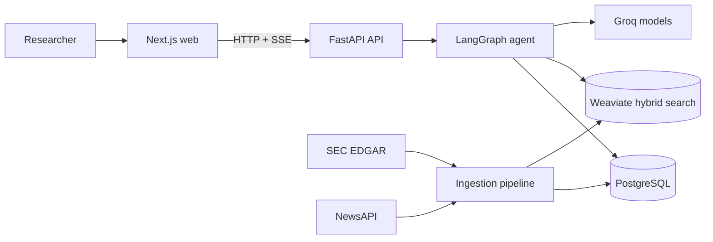
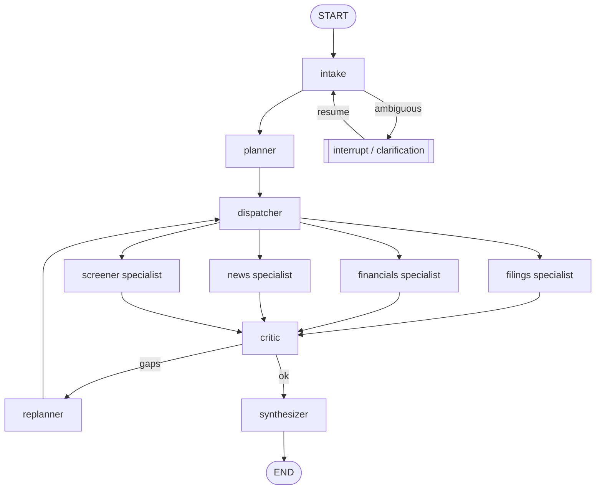

# Financial Intelligence Research Agent

An agentic financial-research workspace built with **LangGraph, Groq, PostgreSQL,
Weaviate, SEC EDGAR, and NewsAPI**. Ask a question in natural language; the system
resolves companies, builds an execution plan, runs specialist tools in parallel,
checks the result, and returns a cited answer.

## Status

- **Phases 0-5:** done, including the agreed 10-company sample workflow
  ([D-022](docs/DECISIONS.md#d-022)).
- **Full run:** pending for the 205-company universe
  ([D-018](docs/DECISIONS.md#d-018)); the free-tier, resumable process is expected to
  take about two weeks ([D-026](docs/DECISIONS.md#d-026)).
- **Live eval results:** pending the owner-run live evaluation; scripted output is only
  harness validation, not agent quality ([D-041](docs/DECISIONS.md#d-041)).

Deployment, the final end-to-end browser suite, and the full-run report remain next
steps. Runtime counts and quality numbers are intentionally not invented; fill the
marked placeholders from your own runs.

## What this project does

- Researches SEC 10-K risk factors, 8-K events, XBRL financial facts, and financial news.
- Uses specialist LangGraph branches for filings, financials, news, and cross-company SQL.
- Preserves thread state in PostgreSQL so clarification turns can resume safely.
- Exposes a FastAPI API with SSE run events and a Next.js research workspace.
- Includes a zero-token scripted evaluation harness for validating the harness itself.

## Architecture



The browser uses the read-only data routes for Companies and Insights, and the
thread/run routes for interactive research. In Docker, server-side frontend requests
use `INTERNAL_API_URL=http://api:8000`; browser requests use
`NEXT_PUBLIC_API_URL=http://localhost:8000`.

## LangGraph execution graph



## How this uses LangGraph

The implementation is in [backend/src/agent/graph.py](backend/src/agent/graph.py)
and the state contract is in
[backend/src/agent/state.py](backend/src/agent/state.py).

| LangGraph feature | How it is used | Source |
|---|---|---|
| Typed graph state | Carries query, immutable plan, step results, evidence, and messages. | [state.py](backend/src/agent/state.py) |
| Reducers | Merges parallel step results and resets evidence at the start of each turn. | [state.py](backend/src/agent/state.py) |
| Conditional routing | Routes intake, planning, criticism, replanning, clarification, and synthesis. | [graph.py](backend/src/agent/graph.py) |
| Parallel execution | Dispatches independent plan steps to specialist branches. | [graph.py](backend/src/agent/graph.py) |
| Specialist subgraphs | Groups filings, financials, news, and screener work behind tool calls. | [specialists.py](backend/src/agent/specialists.py) |
| Interrupt/resume | Pauses for ambiguous company/entity clarification and resumes the thread. | [nodes/intake.py](backend/src/agent/nodes/intake.py) |
| Durable checkpointing | Stores thread state in PostgreSQL through the configured checkpointer. | [checkpoint.py](backend/src/agent/checkpoint.py) |
| Replanning | Critic gaps can send execution back through a revised plan. | [nodes/planning.py](backend/src/agent/nodes/planning.py) |
| Structured synthesis | Produces cited Markdown answers from collected evidence. | [nodes/answer.py](backend/src/agent/nodes/answer.py) |

## Data pipeline

The ingestion package retrieves filings from SEC EDGAR and articles from NewsAPI,
extracts filing sections and XBRL facts, classifies sectors and risk factors, chunks
documents, and indexes derived chunks in Weaviate. PostgreSQL remains the source of
truth for companies, filings, risk factors, 8-K events, financial facts, articles,
agent runs, and ingestion jobs.

The sample workflow is designed for a small local dataset. Full-run figures are
intentionally left for the owner to fill after a real run:

- Companies successfully ingested: **[TODO: fill from full ingestion report]**
- Filings: **[TODO: fill from full ingestion report]**
- Risk factors: **[TODO: fill from full ingestion report]**
- Weaviate chunks: **[TODO: fill from full ingestion report]**
- Sector/risk tagging accuracy: **[TODO: fill from reviewed scoring report]**

See [ingestion/src/ingestion](ingestion/src/ingestion) and
[backend/src/core/db/schema.py](backend/src/core/db/schema.py) for the pipeline and
storage model.

## Setup

Prerequisites: Docker Desktop, `uv`, Node.js 22, and a Groq API key for live agent
work. The scripted runtime and unit tests do not call Groq.

```powershell
Copy-Item .env.example .env
.\make.ps1 install
uv run pre-commit install
.\make.ps1 up
.\make.ps1 ready
```

The five commands above install dependencies, install the one-time hook, start
PostgreSQL/Weaviate/API/web, and verify readiness. Set `GROQ_API_KEY` in `.env` before
live agent work. Do not commit `.env`.

Useful local URLs:

- Web: http://localhost:3000
- API docs: http://localhost:8000/docs
- Health: http://localhost:8000/health and http://localhost:8000/ready

## Environment variables

Configuration is loaded by [backend/src/core/config.py](backend/src/core/config.py).
The main variables are:

| Variable | Purpose |
|---|---|
| `GROQ_API_KEY` | Groq authentication for live model calls. |
| `AGENT_RUNTIME` | `live` for Groq or `scripted` for deterministic zero-token runs. |
| `AGENT_MODEL_REASONING` / related model settings | Selects configured agent models. |
| `DATABASE_URL` | PostgreSQL connection string. Docker composes this for the API. |
| `WEAVIATE_HTTP_HOST` / `WEAVIATE_HTTP_PORT` | Weaviate HTTP connection. |
| `NEXT_PUBLIC_API_URL` | Browser-visible API URL. |
| `INTERNAL_API_URL` | Docker-only server-component API URL; defaults to `http://api:8000` in Compose. |
| `CORS_ORIGINS` | JSON list of allowed browser origins. |
| `NEWSAPI_KEY` | Optional live NewsAPI ingestion credential. |

Use [.env.example](.env.example) as the placeholder-only template.

## Testing and evaluation

Run the full local checks with:

```powershell
.\make.ps1 check
```

The Phase 6 harness supports a zero-token validation mode:

```powershell
.\make.ps1 eval-dry
```

Dry-run output is **harness validation, not agent quality**. It must not be presented
as measured agent performance. Live evaluation is guarded by the agent-model token
ledger and should only be run intentionally:

```powershell
.\make.ps1 eval-live
```

Current measured evaluation results: **[TODO: fill from a saved live eval report]**.
Citation calibration remains at the existing `0.585` threshold; see
[D-038](docs/DECISIONS.md#d-038) and the saved report used for any future number.

## Limitations and honest constraints

- The free Groq tier constrains request and token throughput; ingestion is resumable
  and risk tagging uses batching, caching, and similarity-based inheritance as recorded
  in [D-003](docs/DECISIONS.md#d-003).
- News and SEC data depend on external rate limits, source availability, and API keys.
- The scripted runtime validates wiring and result shapes, not model quality.
- The local sample is not evidence that the full universe has been ingested.
- No production deployment or public URL is claimed by this repository yet.
- Screenshots: **[TODO: add screenshots after the final UI review]**

## Next steps

1. Run and save the full ingestion report, then replace the pipeline placeholders.
2. Run the live eval under the budget guard and link its saved report.
3. Add and run the Playwright scripted E2E suite.
4. Review deployment configuration and perform an owner-approved deployment.
5. Fill only numbers backed by those real artifacts.

See [docs/ARCHITECTURE.md](docs/ARCHITECTURE.md),
[BUILD_SPEC.md](BUILD_SPEC.md), and
[docs/DECISIONS.md](docs/DECISIONS.md) for the detailed design and decision history.
