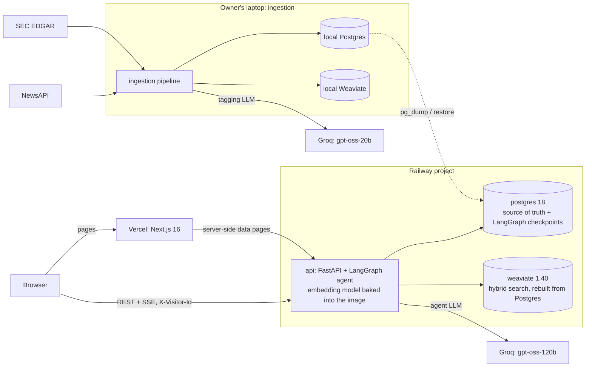
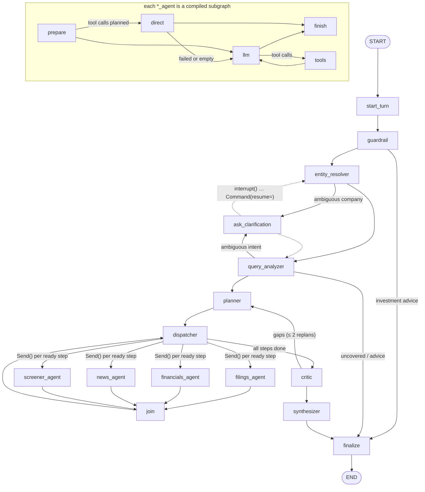

# Financial Intelligence Research Agent

**Live demo: <https://financial-research-agent-olive.vercel.app>**

Ask a research question about public companies in plain English, for example "Compare the
top risk factors NVIDIA and AMD disclosed in their latest 10-Ks". A LangGraph agent
resolves the companies, plans the work, and runs filings, financials, news and screener
specialists in parallel against SEC EDGAR data and stored news. A critic checks the results
and can replan. The answer cites every claim, and before you see it each citation is
checked against its source with a local embedding model. Deterministic checks also hold
the answer to what the tools found. You watch the plan, the graph and the sources fill in
live, and the agent asks when a question is ambiguous ("which bank?").

> **Runs on a 10-company sample** (AAPL, NVDA, AMD, INTC, BA, TSLA, JNJ, UNH, XOM, JPM);
> **full 205-company ingestion pending (free tier).**

<!-- Screenshot slots: add the files to docs/images/ (see docs/images/README.md), then
     uncomment the lines below.


-->

## Trying the demo: recorded runs and live runs

- **Recorded runs (instant, zero tokens).** The example chips marked with a history icon
  replay a real run recorded on the production API: the full stream of agent events, at
  compressed speed. A banner reads **"Recorded live run · <date> · not live"**, and so
  does the run panel. A replay is never presented as live. **Run it live** asks the same
  question for real.
- **Live runs.** Typed questions, and the chips without a recording, run the real agent
  on Groq's free tier. The limits are:
  - **3 live questions per UTC day** per visitor, counted per anonymous browser id and per
    client IP. Answering a clarification doesn't count. At the cap you get a message
    that offers the recordings.
  - **One live run at a time.** Groq's free tier allows 8K tokens per minute, so parallel
    runs would only produce rate-limit errors. Other runs wait in a queue (up to 5) and
    see their position.
  - **A daily agent-token budget** of 100K tokens for the whole site.
- **Private threads, no login.** Your browser gets a random id. The sidebar lists only
  your threads, and other visitors' threads answer 404.
- **Cold start.** If the API doesn't answer within 5 seconds, the page says "Waking the
  free-tier server, about 30–60s" and retries on its own.

How it's built: [D-050](docs/DECISIONS.md#d-050--public-demo-mode-per-visitor-threads-replays-daily-cap-one-live-run).

## Numbers (real, with sources)

**Production runs behind the replays.** Recorded on the production API with
`python -m api.replay_recorder`. Tokens are counted tokens (prompt − cached + completion)
from the API's own run log. Precision is the share of citations the embedding check found
supported by their source.

| Question | Recorded | Tokens | Citation precision | Plan steps |
|---|---|---|---|---|
| Compare NVIDIA and AMD risk factors; does recent news support them? | 2026-11-17 | 13,627 | 1.0 (10/10) | 4 |
| Healthcare companies with the fastest revenue growth, and their regulatory risks | 2026-11-17 | 27,346 | 1.0 (17/17) | 3 |
| "How risky is the bank?" → clarification → JPMorgan | 2026-11-17 | 10,261 | 1.0 (13/13) | 1 |
| Material events Boeing reported in 8-Ks this year | 2026-11-18 | 8,707 | 1.0 (13/13) | 1 |
| "Should I buy Tesla?" (refused by a rule, no LLM call) | 2026-11-17 | 0 | n/a | 0 |

Sources: [`replays/`](replays) and [`docs/demo-runs/README.md`](docs/demo-runs/README.md).

These are the recordings that passed the owner's quality gate (precision ≥ 0.8, no
`[unverified]`, correct freshness line, a sensible answer), not a benchmark. The failed
attempts are kept too:
- **Apple risk changes, 2026-11-17** (8,574 tokens): the answer contradicted its own
  comparison tool.
- **Boeing, 2026-11-17** (7,942 tokens): one row described an 8-K beyond its text.
- **Apple, 2026-11-18** (11,144 tokens): precision 0.786.

Each led to a fix, described below. Apple has no recording yet.

**Production dataset** (from `GET /api/insights/risk-heatmap` on the live API,
2026-11-18): 10 companies, 156 filings, 584 risk factors, 136 8-K events, 443 financial
facts, 1,214 news articles.

**Not measured yet (placeholders, filled only from saved reports):**
- Risk-tag accuracy: **[TODO: owner's `review-score` output on the 30-row labelled sample]**
- Live evaluation (golden questions): **[TODO: saved live eval report]**. The scripted
  eval only validates the harness, not the agent
  ([D-041](docs/DECISIONS.md#d-041--phase-6-eval-harness-uses-api-driven-scripted-validation)).
- Full-universe ingestion: **[TODO: ingestion report once the 205-company run finishes]**

## Architecture



- Postgres and Weaviate are private on Railway (internal network only). The browser
  talks to the API directly, locked to the site's origin by CORS.
- Ingestion runs locally on a different Groq model than the agent, because the free
  tier's quotas are per model
  ([D-027](docs/DECISIONS.md#d-027--agent-and-dev-testing-use-a-different-model-than-ingestion)).
  Production gets the data by `pg_dump`/restore, and Weaviate is rebuilt from Postgres
  with no LLM calls.
- Live NewsAPI calls are off in production. The agent answers from stored news
  ([D-010](docs/DECISIONS.md#d-010--news-store-first-live-newsapi-disabled-in-production-spec-deviation-flag-d)).

### The LangGraph graph



`finalize` is where the answer is checked before anyone sees it. In order:
1. contrast clauses about the earlier 10-K are re-cited to the diff or removed;
2. each citation is verified with the local embedding model;
3. risk statuses and 8-K wording are held to the tools' labels;
4. citations are renumbered 1, 2, 3 in order of appearance;
5. the data-freshness line is added.

## How this uses LangGraph

| Feature | Where | What it does here |
|---|---|---|
| Typed `StateGraph` + custom reducers | [`agent/state.py`](backend/src/agent/state.py) (`merge_keyed`, `evidence_reducer`) | Parallel specialists write different keys of `step_results`. Evidence dedupes by source id, keeps comparison labels, and is reset at the start of each turn ([D-002](docs/DECISIONS.md#d-002--agent-state-immutable-plan-keyed-step-results-resettable-evidence-spec-deviation-flag-b)). |
| Conditional edges | [`agent/graph.py`](backend/src/agent/graph.py) (`_after_*` routers) | Guardrail, entity resolution, clarification, planning errors. |
| `Send` fan-out | [`agent/nodes/planning.py`](backend/src/agent/nodes/planning.py) (`route_after_dispatch`) | One branch per ready plan step, respecting `depends_on`; `join` loops back to the dispatcher. |
| Subgraphs | [`agent/specialists.py`](backend/src/agent/specialists.py) (`build_specialist`) | Each specialist runs planned tool calls directly, falls back to an agentic tool loop (`MAX_TOOL_CALLS`), and streams its own node events. |
| `interrupt()` / `Command(resume=)` | [`agent/nodes/intake.py`](backend/src/agent/nodes/intake.py) (`ask_clarification`), [`api/routes/threads.py`](backend/src/api/routes/threads.py) (`/resume`) | "Which bank?" pauses the run, and the answer resumes it at the node that asked. |
| Durable checkpointer | [`agent/checkpoint.py`](backend/src/agent/checkpoint.py) (`postgres_saver`) | Threads survive restarts; the API reads thread history with `aget_state`. |
| Streaming | [`api/runtime.py`](backend/src/api/runtime.py) (`astream(stream_mode=["custom","messages","tasks"], subgraphs=True)`) | Custom events from `get_stream_writer()`, node starts and ends (subgraphs included), and synthesizer tokens. All become typed SSE events ([D-041](docs/DECISIONS.md#d-041--api-native-fastapi-sse-runs-in-background-tasks-typed-events)). |
| Bounded loops | `MAX_REPLANS` ([`nodes/answer.py`](backend/src/agent/nodes/answer.py)), `MAX_DISPATCH_ROUNDS` ([`nodes/planning.py`](backend/src/agent/nodes/planning.py)), `MAX_CLARIFICATIONS` ([`nodes/intake.py`](backend/src/agent/nodes/intake.py)), `RECURSION_LIMIT` ([`graph.py`](backend/src/agent/graph.py)) | Replans, dispatch rounds and clarifications are capped, so a run always ends. |
| Graph introspection | [`api/routes/data.py`](backend/src/api/routes/data.py) (`get_graph`) | `GET /api/graph` serves the nodes and edges that the UI's live Graph panel lights up. |
| Checkpoint replay | [`agent/__main__.py`](backend/src/agent/__main__.py) (`replay`) | `uv run python -m agent replay` walks a thread's checkpoint history. |

## Engineering decisions and bugs I caught

Each entry links to its full write-up in [`docs/DECISIONS.md`](docs/DECISIONS.md).

- **Chunk size vs the embedding model's 512-token limit**
  ([D-001](docs/DECISIONS.md#d-001--chunk-size-450-tokens--60-overlap-not-800-spec-deviation-flag-a)).
  The spec's 800-token chunks would have been silently truncated by bge-small, so about
  35% of each chunk would never reach the vector while BM25 still saw it. Chunks are now
  ~450 tokens, counted with the model's own tokenizer, and a test enforces the limit.
- **Reducers for parallel state**
  ([D-002](docs/DECISIONS.md#d-002--agent-state-immutable-plan-keyed-step-results-resettable-evidence-spec-deviation-flag-b)).
  Parallel `Send` branches writing one `plan` key raise `InvalidUpdateError`. An
  append-only evidence list would also let a follow-up question cite the previous
  turn's sources. Fixed with a keyed `step_results` merge and a resettable evidence
  reducer.
- **The XBRL fiscal-year trap**
  ([D-004](docs/DECISIONS.md#d-004--xbrl-annual-values-dedupe-by-reporting-period-not-fy-spec-deviation-flag-e)).
  A 10-K tags its prior-year comparatives with its own `fy`, so "FY2024 revenue" can
  return three numbers. Values are identified by the period's end date and deduped with
  the latest filing winning, so restatements apply.
- **An autogenerated migration dropped the checkpoint tables**
  ([D-038](docs/DECISIONS.md#d-038--citation-verification-with-the-local-embedding-model),
  incident note). Alembic didn't know LangGraph's tables and proposed dropping them,
  which went unnoticed until applied. Since then autogenerate ignores tables it doesn't
  own, generating and applying a migration are separate steps, and every data operation
  starts with a verified backup
  ([D-040](docs/DECISIONS.md#d-040--backups-pg_dump-of-postgres-restore-proven-data-safety-rules)).
- **Risk-tag batches that fail validation**
  ([D-003](docs/DECISIONS.md#d-003--risk-tagging-that-fits-groqs-free-tier-spec-deviation-flag-c)).
  Groq rejects a strict-schema violation without reporting the tokens it spent. Each
  batch gets at most two attempts. Valid tags are kept, the rest become `other` with
  `needs_review`, and the report counts them, so a bad batch can't quietly burn the
  quota or mislabel risks.
- **A stale answer to "Did the NVIDIA CEO resign?", and the freshness fix**
  ([D-047](docs/DECISIONS.md#d-047--source-freshness-is-explicit-for-recent-event-questions),
  [D-048](docs/DECISIONS.md#d-048--event-answers-lead-with-the-8-k-news-ranked-by-page-kind-from-owner-config),
  [D-049](docs/DECISIONS.md#d-049--freshness--when-we-last-checked-the-source-not-the-newest-item)).
  The first live run planned news only. It left the 8-K (Item 5.02, 12 Nov) uncited,
  cited an opinion letter, and scored precision 0.571. Event questions now get an 8-K
  step and lead with the filing, news is ranked by page kind, and the data line reports
  when each source was last *checked*, not just the newest item.
- **The model contradicting its own comparison tool: Apple**
  ([D-051](docs/DECISIONS.md#d-051--answers-must-keep-the-tools-own-labels-risk-status-8-k-items),
  [D-052](docs/DECISIONS.md#d-052--change-claims-rest-on-a-diff-source)).
  - *First attempt:* the answer called reworded risks "unchanged … identical language"
    while the tool counted 20 materially changed, and still scored precision 1.0. Now
    every compared risk carries the tool's status label, and `finalize` removes any
    sentence that contradicts it.
  - *Second attempt:* clauses like "whereas FY 2025 did not mention AI" had no citable
    text to match (precision 0.786). Each changed risk now has its own citable diff
    source. Such clauses are re-cited to the diff when its passages back them, and
    removed otherwise. On the real draft precision rose from 0.786 to 1.0 with the same
    threshold.
- **The 8-K wording rewrite: Boeing**
  ([D-051](docs/DECISIONS.md#d-051--answers-must-keep-the-tools-own-labels-risk-status-8-k-items)).
  The answer turned the title of Item 5.02 into events the filing doesn't report
  ("departure of certain officers and the appointment of new directors"). A claim citing
  only 8-Ks may now use event words only if the filing excerpt contains them; otherwise
  it is replaced by the item's official name. This fired, correctly, in the Boeing replay
  you can watch.

## Limitations

- **Free-tier budget.** Groq's free tier allows 200K tokens per day per model and 8K tokens
  per minute, shared by the live site and the owner's development. The site stops at
  100K agent tokens per day, takes one live run at a time, and allows 3 live questions per
  visitor per day. A single comparison can use ~13–27K tokens (see Numbers).
- **10-company sample.** Answers cover AAPL, NVDA, AMD, INTC, BA, TSLA, JNJ, UNH, XOM and
  JPM only. Other companies get a polite "not covered". The 205-company run resumes daily
  within the free quota
  ([D-018](docs/DECISIONS.md#d-018--company-universe-205-large-caps-validated-against-sec-tickers),
  [D-026](docs/DECISIONS.md#d-026--run-level-token-accounting-and-the-daily-full-run-mode)).
- **Railway trial.** The API, Postgres and Weaviate run on a Railway trial (up to 30 days or
  $5 of usage). The exit plan is in [`docs/RAILWAY_EXIT.md`](docs/RAILWAY_EXIT.md).
- **Deterministic checks use fixed word lists.** The status, 8-K and change-claim checks
  ([D-051](docs/DECISIONS.md#d-051--answers-must-keep-the-tools-own-labels-risk-status-8-k-items),
  [D-052](docs/DECISIONS.md#d-052--change-claims-rest-on-a-diff-source)) behave the same
  way every time and are easy to audit, but a contradiction phrased in words outside the
  lists gets through.
- **The citation check measures topic, not reasoning.** It confirms that a cited source is
  about the claim, with a calibrated threshold of 0.585, not that the claim follows from
  it ([D-038](docs/DECISIONS.md#d-038--citation-verification-with-the-local-embedding-model)).
- **Limits are in memory.** One API instance keeps the daily caps and the queue in memory,
  so a restart resets today's counts. The token budget is the hard ceiling.
- **Recordings are dated.** A replay shows the data as it was on its recording date.

## Run it locally

Prerequisites: Docker Desktop, `uv`, Node.js 22, and a Groq API key for live agent work.
Tests and the scripted runtime make no Groq calls.

```powershell
Copy-Item .env.example .env      # placeholders only; add your own keys
.\make.ps1 install
uv run pre-commit install
.\make.ps1 up                    # Postgres, Weaviate, API, web
.\make.ps1 ready
.\make.ps1 ingest-sample         # the 10-company sample (spends ingestion-model tokens)
```

- Web: <http://localhost:3000> · API docs: <http://localhost:8000/docs>
- All settings are in [`backend/src/core/config.py`](backend/src/core/config.py) and
  documented in [`.env.example`](.env.example). They include the demo limits
  (`LIVE_RUNS_PER_VISITOR_PER_DAY`, `LIVE_RUNS_PER_IP_PER_DAY`, `CLIENT_IP_HEADER`,
  `LIVE_CONCURRENCY`, `LIVE_QUEUE_MAX`, `AGENT_DAILY_TOKEN_BUDGET`).

## Testing

```powershell
.\make.ps1 check                         # ruff, mypy --strict, pytest, ESLint, tsc
npm --prefix frontend run test:e2e       # Playwright against the scripted runtime (0 tokens)
```

- Unit and API tests replace the LLM with a scripted fake, and HTTP with `respx`.
- Integration tests use the local stack and skip when it's down. Live tests are opt-in
  (`-m live`).
- The Playwright suite refuses to start unless the API reports the scripted runtime. It
  covers the workspace, replays, the daily cap, per-visitor threads and the cold-start
  screen.

## More

- [`docs/DECISIONS.md`](docs/DECISIONS.md): every design decision and deviation, with the
  reason
- [`docs/ARCHITECTURE.md`](docs/ARCHITECTURE.md) · [`BUILD_SPEC.md`](BUILD_SPEC.md) ·
  [`docs/DEPLOY_PLAN.md`](docs/DEPLOY_PLAN.md) · [`docs/RAILWAY_EXIT.md`](docs/RAILWAY_EXIT.md)
- [`docs/demo-runs/`](docs/demo-runs): transcripts of every live demo run, including
  the failed ones
