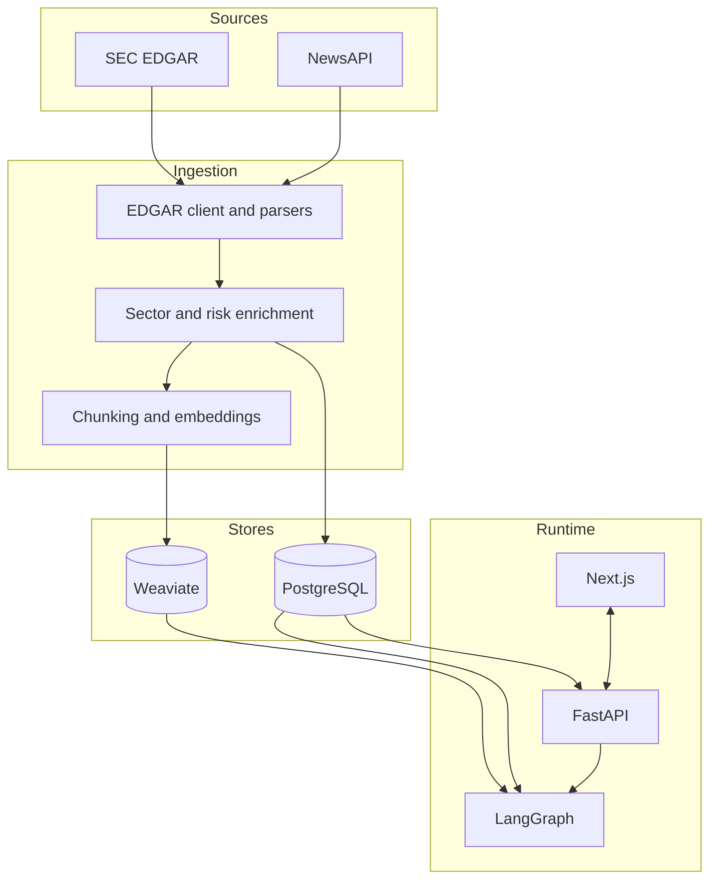
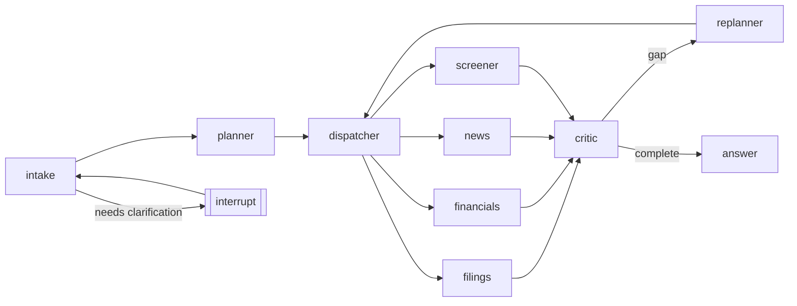

# Architecture

This document describes the implemented shape of the Financial Intelligence Research
Agent. The specification remains in [BUILD_SPEC.md](../BUILD_SPEC.md); deviations and
trade-offs are recorded in [DECISIONS.md](DECISIONS.md).

## Components

### Backend

- [backend/src/api/main.py](../backend/src/api/main.py) creates the FastAPI
  application and dependency lifecycle.
- [backend/src/api/routes/threads.py](../backend/src/api/routes/threads.py) exposes
  threads, runs, SSE events, clarification, and resume behavior.
- [backend/src/api/routes/data.py](../backend/src/api/routes/data.py) exposes the
  read-only Companies and Insights data surfaces.
- [backend/src/core/db/schema.py](../backend/src/core/db/schema.py) defines the
  relational model.
- [backend/src/core/vectorstore.py](../backend/src/core/vectorstore.py) owns the
  Weaviate client and hybrid retrieval integration.

### Frontend

- [frontend/app/page.tsx](../frontend/app/page.tsx) is the Research workspace.
- [frontend/app/companies/page.tsx](../frontend/app/companies/page.tsx) provides the
  searchable company table.
- [frontend/app/insights/page.tsx](../frontend/app/insights/page.tsx) provides the
  risk heatmap and ingestion statistics.
- [frontend/components](../frontend/components) contains the shared dark-first UI.
- [frontend/lib](../frontend/lib) contains typed API helpers and normalization logic.

### Ingestion

- [ingestion/src/ingestion/edgar](../ingestion/src/ingestion/edgar) handles SEC
  retrieval and filing parsing.
- [ingestion/src/ingestion/enrich](../ingestion/src/ingestion/enrich) handles
  classification and risk tagging.
- [ingestion/src/ingestion/load/chunker.py](../ingestion/src/ingestion/load/chunker.py) creates
  embedding-sized chunks.
- [ingestion/src/ingestion/__main__.py](../ingestion/src/ingestion/__main__.py) provides the
  resumable ingestion entry point.

## Agent graph

The graph is assembled in [backend/src/agent/graph.py](../backend/src/agent/graph.py).
The nodes are split across [backend/src/agent/nodes](../backend/src/agent/nodes), and
specialist execution is in
[backend/src/agent/specialists.py](../backend/src/agent/specialists.py).
The immutable-plan and reducer choices are documented in
[D-002](DECISIONS.md#d-002).

## Data flow

1. The ingestion CLI reads the company universe and fetches SEC/NewsAPI data.
2. Parsers normalize filings, 8-K events, XBRL facts, and article metadata.
3. Enrichment assigns sector and risk categories; PostgreSQL stores the canonical rows.
4. Chunks are embedded locally and indexed in Weaviate for hybrid retrieval.
5. A user sends a query to FastAPI; the graph analyzes entities and creates a plan.
6. Independent plan steps fan out to specialist tools, which read PostgreSQL and
   Weaviate and return structured evidence.
7. The critic can request a replan; the synthesizer creates a cited answer.
8. Run events stream through the API to the Next.js workspace, while checkpoints and
   run accounting remain durable in PostgreSQL.

## Key decisions

- **Chunk sizing:** approximately 450 model tokens with 60-token overlap to respect
  the embedding model limit and improve citation precision. See
  [D-001](DECISIONS.md#d-001).
- **State and reducers:** immutable plans, keyed step results, and a resettable
  evidence reducer prevent concurrent-write and cross-turn contamination. See
  [D-002](DECISIONS.md#d-002).
- **Free-tier-aware tagging:** latest-year LLM tagging, similarity inheritance,
  batching, caching, and bounded retries keep ingestion resumable. See
  [D-003](DECISIONS.md#d-003).
- **Annual XBRL values:** deduplicate by reporting period rather than filing fiscal
  year metadata. See [D-004](DECISIONS.md#d-004).
- **Citation calibration:** the current threshold is retained until evaluation provides
  evidence for recalibration. See [D-038](DECISIONS.md#d-038).
- **Scripted eval safety:** the harness validates against an explicitly advertised
  scripted API runtime and labels outputs as harness validation. See
  [D-041](DECISIONS.md#d-041).

## Operational boundaries

PostgreSQL is the durable source of truth and must be backed up before migrations or
bulk data operations. Weaviate is derived and can be rebuilt locally from PostgreSQL.
Live model calls, ingestion, and evaluation consume external quotas; tests use fakes,
mocked HTTP, or the scripted runtime instead.
